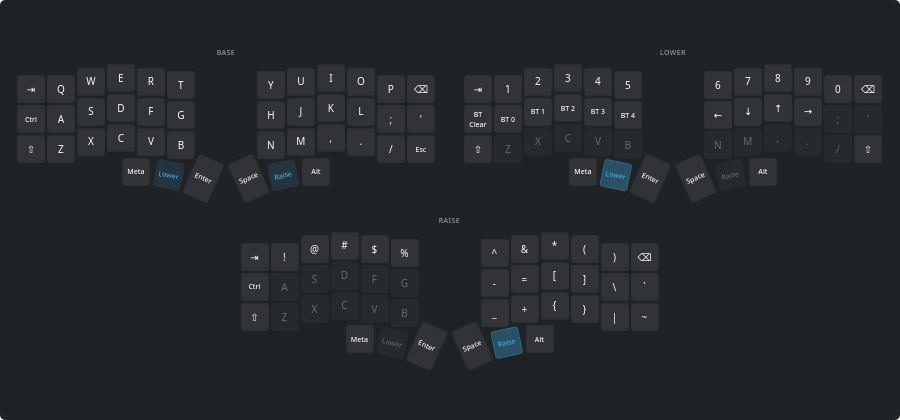
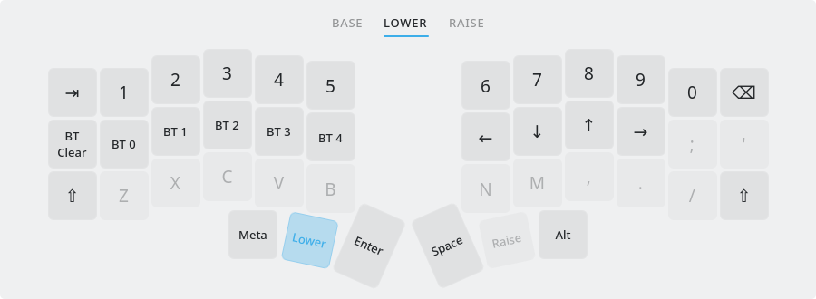

# ZMK Keymap for Plasma

A KDE Plasma 6 widget that shows the keymap actually on your ZMK keyboard, read
straight off the board over ZMK Studio's USB connection. No zmk-config repo,
keymap-drawer run, or hand-kept SVG to drift out of date.



Every layer is a tile, arranged in whichever grid gives the biggest keys for
the widget's shape: side by side when wide, stacked when tall, 2x2 and so on in
between, with a short last row centered. Resize the widget and the tiles
re-flow. Keys use the board's real physical layout (rotated thumb clusters
included) and the Plasma color scheme, so it follows light, dark, and the
background-less desktop mode.



Set **Layers** to *One at a time* for a single layer with a tab strip; scroll
or click a layer key to switch.

- Transparent keys show the base layer through them, faintly.
- The key that holds a layer is highlighted on that layer.
- Hold-taps show the tap legend with the hold underneath.
- Legends come as symbols or words, and hovering a key shows its full binding.

## Requirements

- Plasma 6 (developed on 6.8) and `python3` (stdlib only).
- ZMK firmware with Studio over USB: `CONFIG_ZMK_STUDIO=y` and the
  `studio-rpc-usb-uart` snippet, plus a key bound to `&studio_unlock`. See
  <https://zmk.dev/docs/features/studio>.
- Read access to the keyboard's serial port (`uucp` group on Arch, `dialout`
  on Debian/Fedora).

## Install

```sh
make install     # kpackagetool6 -t Plasma/Applet -i package
make upgrade     # after pulling changes
```

Then add **ZMK Keymap** from Add Widgets. With the keyboard on USB, click
**Read from Keyboard** (or *Read Keymap from Keyboard* in the context menu) and
press your `&studio_unlock` key if asked. The keymap is cached in
`~/.local/share/plasma-zmk-keymap/keymap.json`, so the widget keeps working
with the keyboard unplugged or on Bluetooth. Read it again after you flash new
firmware or change the keymap in Studio.

A running plasmashell keeps the old QML cached after an upgrade;
`plasmashell --replace` picks up the new one.

## The helper

`package/contents/code/zmkkeymap.py` does the talking to the keyboard and is
usable on its own:

```sh
python3 package/contents/code/zmkkeymap.py probe   # name + lock state, no unlock needed
python3 package/contents/code/zmkkeymap.py fetch   # read keymap, update the cache
python3 package/contents/code/zmkkeymap.py show    # print the cache
```

It speaks the ZMK Studio RPC protocol (protobuf over a framed serial stream)
with a hand-rolled codec covering just the messages it needs, and turns
behavior bindings into legends using the behavior metadata the firmware
reports. The cache keeps the raw RPC data next to the rendered layers, so
legend changes can be re-run with `zmkkeymap.py render <file>`.

## Development

```sh
make test        # helper unit tests, including a real Corne fixture
make preview     # render the view offscreen to build/preview/*.png
make lint        # qmllint
```

`tools/preview.sh` renders `KeymapView` without Plasma at a spread of sizes;
`LAYERS=5 tools/preview.sh` pads the keymap to check tile arrangements, and
`plasmawindowed com.nirokato.zmkkeymap` runs the real widget in a window.

## Limits

- Studio's RPC doesn't expose combos, conditional layers, or macro contents,
  so those don't appear.
- Behaviors the firmware doesn't describe to Studio show as `?`.
- USB only; Studio's BLE transport isn't implemented.

Next up: combos via an optional keymap-drawer YAML source, and the BLE
transport.
